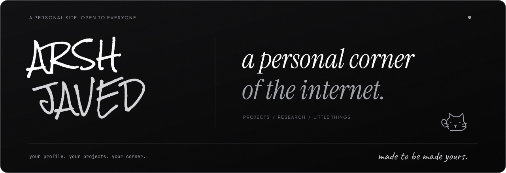

<a href="https://arshjaved.in">
  
</a>

<div align="center">

<br />

[](https://arshjaved.in)
[](#make-it-yours)
[](LICENSE)

<p>Your own live site.</p>


</div>

<br />

## Make it yours

**01** Click **Use this template → Create a new repository**. Make it public.

**02** Edit [`src/config/portfolio.ts`](src/config/portfolio.ts) with your own details.

**03** In **Settings → Pages**, choose **GitHub Actions** as the source.

**04** Push to **main**. Your live link appears in **Settings → Pages**.

## Run on your computer locally

Use **Node.js 26+**

```sh
npm ci
npm run dev
```

Open **[localhost:8080](http://localhost:8080)**. Before pushing, run `npm run format`, `npm run lint`, and `npm run build`.

---

<div align="center">
  <sub>Made with care. Open for you to make your own.<br />
  <a href="CONTRIBUTING.md">Small improvements welcome ↗</a></sub>
</div>
